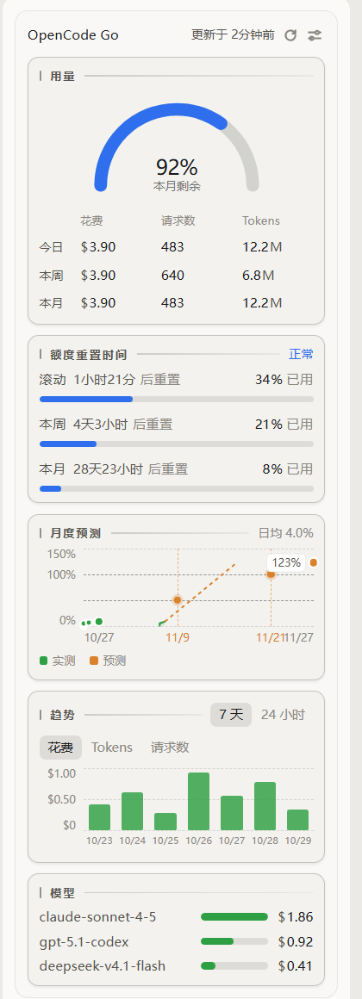
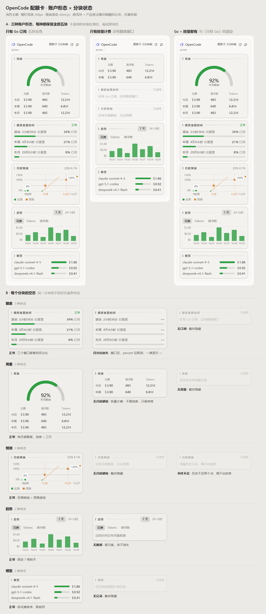

<div align="center">
  
</div>

<h1 align="center">OpenCode 套餐面板</h1>

<p align="center">
  <b>在 DeepSeek Harness 侧栏，随时看清 OpenCode Go 的额度、花费和趋势。</b>
</p>

<p align="center">
  
  
  
  
</p>

<p align="center">
  <a href="#安装">安装</a> ·
  <a href="#界面">界面</a> ·
  <a href="#账户形态">账户形态</a> ·
  <a href="docs/README.md">开发与原理</a>
</p>

> [!NOTE]
> 这是 DeepSeek Harness 的第三方插件，不是 OpenCode 官方产品。数据直接来自你配置的 OpenCode 账户。

<div align="center">
  
  <br>
  <sub>侧栏卡片（浅色主题）：用量 · 额度 · 预测 · 趋势 · 模型</sub>
</div>

## 为什么用它

OpenCode Go 的额度分散在几个接口里：滚动窗口、周窗口、月窗口，外加 Console 的花费与 token。这个插件把它们收进一张侧栏卡片，不用打开网页控制台，也不用自己算。

- **一眼看到最紧的额度**：滚动 5 小时 / 本周 / 本月三个窗口，进度条按四档变色，带重置倒计时。
- **知道今天花了多少**：今日花费、请求数、tokens，以及本周 / 本月汇总。
- **看见趋势**：7 天 / 24 小时，花费 / tokens / 请求数随时切换。
- **提前知道会不会用完**：按当前计费周期的花费速度外推，标出 50% / 100% 的预计日期。
- **知道钱花在哪个模型**：按花费排序的模型条形图。
- **多账户不打架**：同一组织的 Key 合并成一张卡，不同组织分开；可切换账户，花费可按服务账号筛选。
- **侧栏收起也能看**：折叠时退化为一个百分比/金额小方块。
- **不打扰**：跟随 DSH 主题、中英双语、无外部 CDN，偏好只存在本机。

## 界面

### 侧栏卡片

- 三个额度窗口：滚动 5 小时 / 本周 / 本月，含重置倒计时与进度条；
- 今日花费、请求数、tokens，以及本周 / 本月汇总；
- 最近 7 天或 24 小时的花费 / tokens / 请求数趋势；
- 当前计费周期的额度预测：按当前速度是否会在重置前用完；
- 模型花费条形图；
- 账户切换菜单：组织一行，组织下的服务账号各一行。

### 设置 → OpenCode 套餐

- **账户**：列出 DSH 里的账户和各自 provider 凭据（只读，Key 在 DSH 的 provider 设置里改）；当前账户打绿色「当前」tag，其余可「切换」；右上「刷新数据」立即重读；
- **卡片展示**：预览五个分块，勾选控制是否显示在侧栏，拖拽标题调整顺序，`?` 里有说明；
- **趋势图**：7 天 / 24 小时切换，花费 / tokens / 请求数切换；
- **显示**：色条开关与颜色、四档进度条（名称 / 区间 / 颜色）、刷新间隔（30 秒 / 1 分钟 / 5 分钟 / 15 分钟）。

<details>
<summary><b>查看三种账户形态与每个分块的空态参考图</b></summary>
<br>

</details>

## 账户形态

卡片的五个分块由**接口数据**决定，不是配置开关，也不看 provider 名：

| 形态 | 你会看到 |
| --- | --- |
| 只有 Go 订阅 | 五个分块齐全 |
| 只有 Console 按量 | 额度与预测隐藏，保留用量、趋势、模型 |
| Go + Console | 合并成一张卡，与「只有 Go」一致 |

插件用 `GET /inference/go/v1/usage` 的 200/404 判断有没有 Go 订阅，provider id 只决定优先用哪把 Key。完整规则见 [开发与原理 → 账户形态](docs/README.md#账户形态)。

## 安装

### 环境

- DeepSeek Harness Desktop 0.2.x（开发环境 `0.2.1-rc.5`；Web profile 同理）；
- 一个 OpenCode Go 订阅，或仅有 Console 用量的 OpenCode 账户；
- 能访问 `opencode.ai`。

### 从 GitHub 安装（推荐）

```sh
dsh plugin --profile desktop add github:zhxmt-xm/dsh-opencode-quota
```

Web 版 profile：

```sh
dsh plugin --profile web add github:zhxmt-xm/dsh-opencode-quota
```

> 安装后**完全退出 DSH 再启动**，Host 半边才会加载。

### 本地开发安装

也可以在 GUI 里安装：左侧栏 → **插件** → **添加插件**，粘贴本仓库绝对路径，安装后点 **立即启用**。

```powershell
# Windows PowerShell
dsh plugin --profile desktop add "link:C:\code\dsh-opencode-quota"
```

```sh
# macOS / Linux
dsh plugin --profile desktop add "link:$PWD"
```

`link:` 直接引用本地目录，改代码后重启宿主即可，不需要重新安装。

### 配置 Key

插件读取 DSH 里已有的 `opencode` / `opencode-go` provider 凭据：

1. 打开 DSH 设置 → Providers（`llm-pi-ai`）；
2. 配置 `opencode-go` 和/或 `opencode` 的 API Key；
3. 回到「设置 → OpenCode 套餐」，点「刷新数据」。

Key 也可以走环境变量回退：`OPENCODE_GO_API_KEY` / `OPENCODE_API_KEY`。插件设置页只读，不会把 Key 下发到浏览器。

### 更新 / 卸载

```sh
# 更新：重新执行一次 add 即可
dsh plugin --profile desktop add github:zhxmt-xm/dsh-opencode-quota

# 卸载
dsh plugin --profile desktop remove @local/dsh-opencode-quota
```

## 数据与隐私

- Key 只在 DSH Host 进程内使用，不下发到浏览器、不写日志；
- 额度数据不落盘；界面偏好存在浏览器 `localStorage`；
- 所有 Host 路由只接受本机回环请求，并校验 `Origin` / `sec-fetch-site`；
- 上游请求 12 秒超时、拒绝重定向、响应体上限 256 KB。

## 已知限制

- 只判断有没有 Go 订阅，分不清 Go / Go Plus；
- 预测只用当前计费周期的每日花费，数据不足两个点时隐藏；
- 模型只有区间总量，没有按模型按天的数据；
- 自定义 provider 指向非 `opencode.ai` 中转站时不会被识别；
- 设置导航图标是 DOM 补丁，DSH 改导航结构时需要适配。

完整原因与处理方式见 [开发与原理 → 已知限制](docs/README.md#已知限制)。

## 开发

- 原生 ESM + React（由 DSH 提供），无构建步骤、无运行时依赖；
- Host：`index.js`；Client：`client.js`；bundle patch：`cordis.patch.yml`；
- 冒烟测试：`node .smoke.mjs`（当前 32 项全部通过）；
- 参考图生成：`node docs/render-scenarios.cjs`。

架构、接口、缓存、偏好 schema、调试方式与发布检查见 [docs/README.md](docs/README.md)。

## 许可

- 插件代码：MIT，见 [LICENSE](LICENSE)；
- 内嵌 Noto Sans SC 字体：SIL OFL 1.1，见 [THIRD_PARTY_NOTICES.md](THIRD_PARTY_NOTICES.md)。

---

<div align="center">
  <sub>Made for DeepSeek Harness · 数据来自 OpenCode</sub>
</div>
